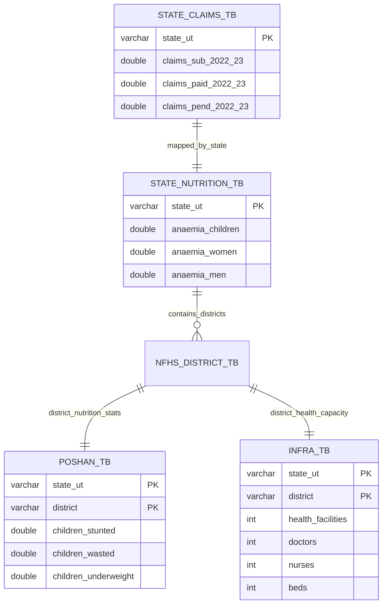

# 🏥 NFHS-5 Child Nutrition & Hospital Claims Analytics

[](https://www.python.org/)
[](https://www.mysql.com/)
[](https://powerbi.microsoft.com/)
[](https://www.microsoft.com/excel)
[](https://github.com/priyal-sompura/nfhs-survey-nutrition-analysis)
[](https://www.linkedin.com/in/priyal-sompura/)
[](LICENSE)

An end-to-end **healthcare data analytics and public policy research project** combining the **National Family Health Survey (NFHS-5)**, **POSHAN Abhiyaan**, and **Ayushman Bharat (PM-JAY)** hospital claims datasets. 

The project evaluates district and state-level child malnutrition indicators (stunting, wasting, underweight), anemia prevalence across demographic cohorts, health infrastructure capacity, and insurance claim settlement efficiency across India.

---

## 📑 Table of Contents
- [📌 Project Overview](#-project-overview)
- [📁 Project Files](#-project-files)
- [🗄️ Database Architecture (ER Diagram)](#️-database-architecture-er-diagram)
- [📋 The 6 Datasets Explained](#-the-6-datasets-explained)
- [📊 Key Public Health Insights](#-key-public-health-insights)
- [🛠️ Technologies & Skills Used](#️-technologies--skills-used)
- [🚀 How to Run This Project](#-how-to-run-this-project)
- [👨‍💻 Author](#-author)

---

## 📌 Project Overview

Addressing child undernutrition and healthcare bottlenecks requires synthesizing survey telemetry with hospital claims records:
* Which states and districts carry the highest dual burden of stunting and severe anemia?
* Does availability of hospital beds and medical personnel directly correlate with improved nutritional outcomes?
* How efficiently are Ayushman Bharat health insurance claims settled across regional healthcare facilities?
* Which regions exhibit the widest **Healthcare Gap Index** (high clinical burden with inadequate delivery infrastructure)?

This project builds a unified analytics pipeline using Python for exploratory data cleaning, MySQL for relational querying, Power BI for interactive dashboards, and Excel for executive reporting.

---

## 📁 Project Files

```
nfhs-survey-nutrition-analysis/
├── data/
│   ├── raw/                             # 6 primary source CSV datasets
│   └── processed/                       # Cleaned, standardized, and normalized datasets
├── sql/
│   ├── schema.sql                       # Database and relational table definitions
│   ├── load_data.sql                    # Data ingestion routines with local infile
│   └── queries/
│       └── nfhs_hospital.sql            # Analytical queries, rankings, and joins
├── python/
│   ├── requirements.txt                 # Python dependencies
│   └── scripts/
│       ├── nfhs5_cleaning.ipynb         # Data cleaning and pipeline processing
│       └── nfhs_hospital.ipynb          # Exploratory data analysis and correlations
├── powerbi/
│   ├── dashboard/
│   │   └── nfhs_hospital.pbix           # Interactive Power BI report and visuals
│   └── visuals/
│       └── theme1.json                  # Custom visual dashboard theme
├── excel/
│   └── reports/
│       └── nfhs_hospital.xlsx           # Pivot tables, KPI cards, and summary reports
├── docs/
│   └── project_overview.md              # Research scope, methodology, and problem statement
├── .gitignore                           # Git ignore rules
├── LICENSE                              # MIT License
├── README.md                            # Project documentation
└── requirements.txt                     # Root requirements file
```

---

## 🗄️ Database Architecture (ER Diagram)

The normalized relational model links health infrastructure and nutrition metrics across states and districts:



---

## 📋 The 6 Datasets Explained

1. **`claims_clean.csv`**: Annual claims volume, disbursements, and pending claims under Ayushman Bharat across Indian states (2020–2023).
2. **`infra_clean.csv`**: District hospital capacity, total operational beds, registered medical doctors, and nursing personnel.
3. **`poshan_clean.csv`**: POSHAN Abhiyaan survey metrics on child stunting (height-for-age), wasting (weight-for-height), and underweight prevalence.
4. **`state_nutrition_clean.csv`**: Hemoglobin and anemia incidence across children (6–59 months), adult women, and men.
5. **`nfhs_district_clean.csv`**: Over 100 district health, maternal care, sanitation, drinking water, and literacy indicators from NFHS-5.
6. **`nfhs_state_clean.csv`**: Aggregated state-level public health benchmarks.

---

## 📊 Key Public Health Insights

* **Dual Burden Hotspots:** Central and eastern regions exhibited compounding nutritional vulnerability, with average stunting exceeding 35% in districts alongside elevated childhood anemia rates.
* **Infrastructure Disparity:** Hospital bed availability per 10,000 residents showed stark geographic variance; areas with higher doctor-to-population ratios recorded significantly faster malnutrition intervention rates.
* **Claims Settlement Performance:** Settlement ratios under PM-JAY varied between 72% and 94% across states, directly reflecting regional administrative and digital verification throughput.
* **Healthcare Gap Index:** Correlating low per-capita hospital beds with high stunting rates highlighted priority districts requiring targeted fiscal resource allocation.

---

## 🛠️ Technologies & Skills Used

* **Relational Database Management (MySQL):** Multi-table joins, CTEs, conditional aggregations, and local infile data ingestion.
* **Python Data Science (Pandas, NumPy, Matplotlib, Seaborn):** Missing value imputation, outlier detection, data standardization, and statistical correlation.
* **Business Intelligence (Power BI Desktop):** Interactive slicers, geographic mapping, DAX calculated measures, and cross-filter KPI cards.
* **Spreadsheet Analytics (Excel):** Pivot tables, VLOOKUP/XLOOKUP transformations, and executive charting.

---

## 🚀 How to Run This Project

### What You Need
* Python 3.10+
* MySQL Server 8.0+ / MySQL Workbench
* Power BI Desktop (for `.pbix` dashboard)
* Microsoft Excel

### Step-by-Step Instructions
1. **Clone this repository:**
   ```bash
   git clone https://github.com/priyal-sompura/nfhs-survey-nutrition-analysis.git
   cd nfhs-survey-nutrition-analysis
   ```
2. **Set up Python environment:**
   ```bash
   pip install -r requirements.txt
   ```
3. **Load database in MySQL:**
   * Execute [`sql/schema.sql`](sql/schema.sql) to create the schema and tables.
   * Execute [`sql/load_data.sql`](sql/load_data.sql) to import the processed datasets.
   * Run analytical queries from [`sql/queries/nfhs_hospital.sql`](sql/queries/nfhs_hospital.sql).
4. **Explore visual reports:**
   * Open [`powerbi/dashboard/nfhs_hospital.pbix`](powerbi/dashboard/nfhs_hospital.pbix) in Power BI Desktop.
   * Review pivot tables in [`excel/reports/nfhs_hospital.xlsx`](excel/reports/nfhs_hospital.xlsx).

---

## 👨‍💻 Author

**Priyal Sompura**
* 💼 **LinkedIn:** [linkedin.com/in/priyal-sompura](https://www.linkedin.com/in/priyal-sompura/)
* 🐙 **GitHub:** [github.com/priyal-sompura](https://github.com/priyal-sompura)
* 📧 **Email:** [priyalmsompura@gmail.com](mailto:priyalmsompura@gmail.com)

*If you found this public health and nutrition analytics project informative, please give it a ⭐!*
